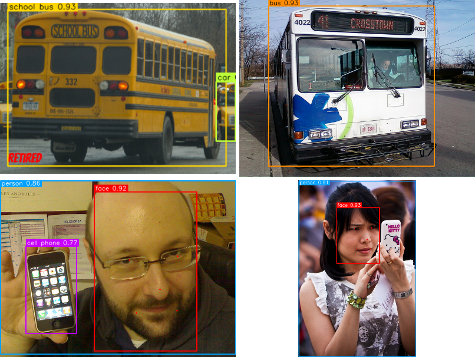

# Face and Object Recognition Application

Real-time recognition of everyday objects, faces, and enrolled people on an ordinary CPU, built with OpenCV and ONNX Runtime and evaluated against public benchmarks.

Built by Margaret Gonzalez for the Advanced Artificial Intelligence course in the Computer Science Graduate Program at Full Sail University. The IEEE-format report is in [`paper/`](paper/).



## Highlights

| Measurement | Result |
|---|---|
| YOLOv10-N on COCO 2017 validation (5,000 images), input 640 | mAP 0.380, mAP@0.5 0.548, 21 frames per second on CPU |
| YOLOv10-N, input 320 | mAP 0.285, 78 frames per second on CPU |
| School bus detection, detector alone | precision 0.23, recall 0.90 |
| School bus detection, detector plus MobileNetV3 refiner | precision 0.90, recall 0.90 |
| SFace verification on LFW (6,000 pairs) | AUC 0.999, accuracy 99.2 percent |
| Open-set identification (20 enrolled people, 200 strangers), three-sigma threshold | 100 percent identified, 0 false accepts |
| Face detection at 30 degree rotation | YuNet 98.7 percent versus Haar cascade 9.7 percent |

## Skills demonstrated

Computer vision pipelines, ONNX model inference, YOLO output decoding and non-maximum suppression, two-stage detection with a classifier refiner, face embeddings and cosine matching, statistical threshold calibration (three-sigma rule), benchmark evaluation (COCO mAP, LFW ROC), pytest testing, and data visualization (graphs and heatmaps in `results/figures/`).

## Privacy

No face photos or face embeddings of real users are stored in this repository. `data/face_gallery.npz` is created on your own computer when you run `enroll.py`, and it is excluded by `.gitignore`.

A Python application that recognizes everyday objects (80 COCO classes, including **school bus**, bus,
**cell phone**, person, laptop, cup, book, car, and truck), detects **faces**, and **names enrolled people** in
real time from a webcam, an image, a folder of images, or a video file. Everything runs on the CPU with
OpenCV and ONNX Runtime; no GPU and no PyTorch are needed.

| Task | Model (folder `models/`) | Size |
|---|---|---|
| Object detection, 80 classes | YOLOv10-N, exported to ONNX (`yolov10n.onnx`) | 9.7 MB |
| School bus check on bus and truck boxes | MobileNetV3-Large ImageNet classifier (`mobilenetv3_large_imagenet.onnx`) | 21.9 MB |
| Face detection with 5 landmarks | YuNet (`face_detection_yunet_2023mar.onnx`) | 0.2 MB |
| Face recognition, 128-value embedding | SFace (`face_recognition_sface_2021dec.onnx`) | 38.7 MB |
| Baseline face detector for comparison | Haar cascade (`haarcascade_frontalface_default.xml`) | 0.9 MB |

## 1. Install on Windows

Open **PowerShell** in the project folder (in File Explorer, open the folder, click the address bar, type
`powershell`, and press Enter).

```powershell
py -3 -m venv .venv
.\.venv\Scripts\Activate.ps1
python -m pip install --upgrade pip
pip install -r requirements.txt
```

If PowerShell blocks the activation script, run `Set-ExecutionPolicy -Scope CurrentUser RemoteSigned` once,
answer `Y`, and activate again. Use OpenCV 4 (the requirements file already pins `opencv-python<5`).

Download the SFace face recognition model (38.7 MB, too large to store in this repository):

```powershell
python download_models.py
```

Optional, for the tests, evaluation scripts, and figures: `pip install -r requirements-eval.txt`

## 2. Run the application

```powershell
python app.py                       # webcam
python app.py --source samples      # the sample photos (press any key for the next photo)
python app.py --source samples\school_bus.jpg
python app.py --imgsz 320 --detect-every 2   # faster settings for a slow computer
```

| Key | Action |
|---|---|
| `s` | Save a screenshot to `screenshots\` |
| `e` | Enroll the largest face in view (type the name in the terminal) |
| `h` | Show or hide the Haar cascade baseline (thin gray boxes) |
| `p` | Show or hide person boxes |
| `+` / `-` | Raise or lower the object confidence threshold |
| `q` or `Esc` | Quit |

Each run writes a CSV log to `results\session_<date>_<time>.csv` (objects, faces, names, and timings).

On screen: colored boxes show objects with confidence; green face boxes show an enrolled person's name and
cosine similarity; red face boxes are "Unknown"; the top line shows frames per second.

## 3. Enroll your face

```powershell
python enroll.py --name "Margaret" --camera     # captures 15 samples; turn your head slightly
python enroll.py --list                         # shows people, samples, and the threshold
python enroll.py --remove "Margaret"
```

Only the 128 numbers per sample are saved (`data\face_gallery.npz`); no photos are stored. The decision
threshold is recalculated with the three-sigma rule each time someone is enrolled:
threshold = mean + 3 x standard deviation of the best-match scores of 500 background faces
(`data\background_embeddings.npy`).

## 4. Tests and speed check

```powershell
python -m pytest -q          # 21 unit and integration tests
python benchmark_speed.py    # milliseconds and frames per second for each step on this computer
```

## 5. Reproduce the evaluation (optional, large downloads)

The scripts in `eval\` expect the public data sets in a `datasets` folder next to this project, or in the
folder named by the `FR_DATA` environment variable:

* `val2017\` and `annotations\instances_val2017.json` from cocodataset.org (COCO 2017 validation, 5,000 photos)
* `lfw_funneled\` and `pairs.txt` (Labeled Faces in the Wild, deep-funneled version)
* `imagenetv2-matched-frequency-format-val\` (ImageNetV2), class folders 407 to 874 listed in `eval_school_bus.py`

```powershell
cd eval
python eval_coco.py              # mAP and speed for YOLOv10-N at 320, 480, 640 and YOLOv10-S at 640
python eval_faces_lfw.py         # 6,000-pair face verification, ROC, thresholds
python eval_face_detectors.py    # Haar versus YuNet under rotation, scale, light, blur, occlusion
python eval_openset.py           # name 20 enrolled people and reject 200 strangers
python eval_school_bus.py        # school bus precision and recall, cell phone detection
python make_figures.py           # every graph and heatmap in results\figures
```

## 6. Project layout

```
download_models.py     downloads the SFace model from the OpenCV model zoo
app.py                 application window, keys, camera or image input, CSV log
enroll.py              add, list, or remove people (embeddings only)
benchmark_speed.py     speed of each step on the current computer
recognizer/
  config.py            file paths and default thresholds
  detector.py          letterbox, YOLOv10 output decoding, non-maximum suppression
  refiner.py           MobileNetV3 school bus check
  faces.py             YuNet, Haar cascade, SFace embedding
  gallery.py           enrolled people, cosine matching, three-sigma threshold
  pipeline.py          runs every step on a frame and draws the results
eval/                  evaluation scripts and figure generation
results/               JSON results, figures, annotated sample outputs
samples/               test photos (COCO 2017 and ImageNetV2)
tests/                 pytest unit and integration tests
models/                ONNX models and the Haar cascade file
```

## Licenses and notes

YOLOv10 and its weights are released under the AGPL-3.0 license by their authors; the YuNet and SFace
models come from the OpenCV model zoo; MobileNetV3 weights come from torchvision. Sample photos come from
the COCO 2017 validation set and ImageNetV2. Face recognition must only be used with the consent of the
people enrolled.
